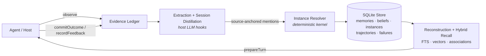

# Ghast Memory OS (gmOS)

**A local-first Memory OS for personal agents** — not a vector-store wrapper.
gmOS gives an agent a durable, evidence-backed model of its user: what happened,
what the user owns and prefers, what changed, what must be forgotten — and it
can explain every byte of context it ever injects into a prompt.

```
npm install @ghast/memory
```

## Why gmOS

Most "agent memory" is top-k retrieval over embedded chat chunks. That breaks
down exactly where long-horizon memory matters: counting ("how many tanks do I
have *now*?"), state ("is that errand still pending?"), time ("what did I
believe before last week?"), and trust ("why is this in my prompt?").

gmOS is built as an operating system for memory instead:

- **Evidence-first writes.** Every durable mutation records an evidence event
  and is reversible — archive, never silent delete. `explain()` walks any
  memory back to its sources.
- **One real-world instance = one record.** Session distillation emits
  source-anchored *mentions*; a deterministic instance resolver reconciles them
  into canonical instances with stable ids, aliases, and state transitions
  (`pending → completed`, `active → not_current`). Counting and enumeration
  read the instance set — they do not re-guess from text.
- **Deterministic kernel, LLMs at the edges.** Extraction, distillation, and
  identity judgment are host-pluggable hooks. The kernel validates, grounds,
  deduplicates, and writes deterministically; it never synthesizes user facts
  on its own, and every hook failure degrades safely instead of corrupting the
  store.
- **Read-path purity.** `prepareTurn`, `reconstructContext`, and every explain
  call are audited against table-state hashes: read paths must not write.
- **Local-first privacy.** SQLite on the user's disk. Secret-like content is
  rejected before persistence, incognito events are never promoted,
  person-routed memory is isolated, and `forget()` removes residue from future
  context. No cloud custody, no required network calls in the kernel.
- **Honest benchmarking.** Deterministic scores and official-protocol LLM
  judging are never mixed. Reports carry protocol labels, judge provenance,
  and reproduction manifests; infrastructure failures are never scored as
  quality failures.

## Quickstart

```ts
import { createMemoryOS } from "@ghast/memory";
import { createSqliteMemoryStore } from "@ghast/memory/store/sqlite";

const memory = createMemoryOS({
  profileId: "local-user",
  store: createSqliteMemoryStore({ path: "./gmos.db" }),
});

await memory.add({
  profileId: "local-user",
  kind: "boundary",
  content: "以后不要再提醒我这个项目延期了。",
});

const prepared = await memory.prepareTurn({
  profileId: "local-user",
  messages: [{ role: "user", content: "这个项目现在怎么办？" }],
});

console.log(prepared.contextBlock); // evidence-backed context, ready to inject
await memory.close();
```

From a clone:

```bash
npm install && npm run build
npm run examples:quickstart
```

## How It Works



The core loop:

1. **`observe()`** — the host streams conversation and tool events. gmOS
   records evidence, applies safety gates, and (with intelligence hooks
   attached) extracts durable candidates and distills sessions into mentions.
2. **Instance resolution** — each mention is reconciled against the profile's
   existing canonical instances: `NEW_INSTANCE`, `SAME_AS` (merge aliases and
   citations), `STATE_TRANSITION`, or `REJECTED`. Identity judgment may use an
   LLM hook; id assignment and writes are deterministic kernel code.
3. **`prepareTurn()`** — reconstructive recall assembles a bounded,
   privacy-gated context block from evidence, beliefs, instances, and
   memories, with deterministic fusion across FTS, vector, and association
   signals.
4. **`commitOutcome()` / `recordFeedback()`** — outcomes reinforce the
   memories that helped; wrong recalls lower confidence without hiding the
   evidence path.
5. **`maintain()`** — explicit, evidence-backed lifecycle: decay to dormant,
   consolidate duplicates, distill repeated trajectories into procedures,
   rebuild exploration indexes. Nothing runs in the background.

## Surfaces

One kernel, four ways in:

| Surface | Entry | For |
| --- | --- | --- |
| **SDK** | `createMemoryOS()` | In-process TypeScript/Node hosts |
| **CLI** | `gmos`, `gmos-inspect` | Init, search, prepare, maintain, doctor, benchmarks |
| **MCP** | `gmos mcp serve` + in-process router | Tool-based agent runtimes (Claude Code, etc.) |
| **HTTP** | `gmos serve` / `gmos http serve` | Any language; scoped API keys, audit log, OpenAPI 3.1, local Memory Console |

```bash
gmos init --db ./gmos.db
gmos add --db ./gmos.db --profile local --kind preference --text "回答风格：简洁，先给结论"
gmos prepare --db ./gmos.db --profile local --text "你之后怎么回答我？"
gmos-inspect turn --db ./gmos.db --profile local --query "这个项目现在是什么状态？" --format markdown
gmos serve --db ./gmos.db --profile local --keys --port 4787 --console
```

JS/TS and Python clients for the HTTP surface:

```ts
import { GmosClient } from "@ghast/memory/client";
const memory = new GmosClient({ baseUrl: "http://127.0.0.1:4787", apiKey: process.env.GMOS_API_KEY! });
```

```python
from gmos_client import GmosClient  # python/, stdlib-only
```

Docker: `docker compose up --build` runs `gmos serve` with a persistent SQLite
DB at `/data/gmos.db` (see `scripts/docker-smoke.sh` for the manual smoke).

## Intelligence Hooks (Opt-In)

The kernel never calls a network by itself. Attach LLM capability explicitly
via `@ghast/memory/intelligence` — factories for OpenAI-compatible extraction,
session distillation, instance resolution, consolidation, procedure
distillation, dossier synthesis, embeddings, reranking, and query planning:

```ts
import { createDefaultIntelligence } from "@ghast/memory/intelligence";

const memory = createMemoryOS({
  profileId: "local-user",
  store,
  ...createDefaultIntelligence({
    baseUrl: process.env.LLM_BASE_URL,
    apiKey: process.env.LLM_API_KEY,
    model: "your-model",
    sessionDistillation: true,
  }),
});
```

Hosts that already own extraction, entity resolution, calendar parsing, or
reconstruction cues can plug in their own hooks instead — gmOS keeps write-path
authority (grounding, dedupe, safety gates, bounded confidence) regardless of
who generates candidates. See the
[integration guide](./docs/INTEGRATION_GUIDE.md) and
[structured extraction](./docs/STRUCTURED_EXTRACTION.md).

## Safety Contract

- Secret-like content never reaches long-term memory.
- Incognito events are never promoted; person-routed memory requires explicit
  opt-in to surface.
- `forget()` archives matching memory and scrubs it from future context;
  residue is measurable via the inspector.
- Read paths are write-audited; reordering hooks (rerankers) can only reorder
  or drop already-gated candidates, never add.
- Encryption at rest is available when the host supplies a
  BetterSqlite3-compatible cipher driver and key; key custody stays with the
  host.

## Benchmarking

Two strictly separated modes:

- **`gmos gym run`** — the deterministic SDK gate: hard safety gates, recall
  contracts, the `experience_horizon` multi-week learning group, scale smoke.
  No LLM involved; runs in CI.
- **`gmos gym external`** — long-memory QA (LongMemEval, LoCoMo, or native
  JSONL) through local adapters. `deterministic_local` scoring is the offline
  default; `official_protocol` requires an explicit host-provided answerer and
  judge and is labeled as such, with judge provenance and reproduction
  manifests in every report.

Official-protocol results are published only with pinned commits, fixed
model/judge settings, and reproduction bundles — see
[benchmarking](./docs/BENCHMARKING.md),
[benchmark claims](./docs/BENCHMARK_CLAIMS.md), and
[benchmark runs](./docs/BENCHMARK_RUNS.md).

```bash
npm run gate:pr        # full local/CI PR gate
npm run release:evidence -- --output-dir ./release-evidence/alpha-local
```

## Documentation

| Doc | What's in it |
| --- | --- |
| [API reference](./docs/API_REFERENCE.md) | Every public SDK/CLI/MCP/HTTP surface |
| [Architecture](./docs/ARCHITECTURE.md) | Kernel design, stores, indexes, read-path audits |
| [Integration guide](./docs/INTEGRATION_GUIDE.md) | Wiring gmOS into agents and hosts |
| [Structured extraction](./docs/STRUCTURED_EXTRACTION.md) | Host extractor candidate contract |
| [Benchmarking](./docs/BENCHMARKING.md) | Score semantics, protocols, claim rules |
| [Roadmap](./docs/ROADMAP.md) | Where this is going, and the invariants that never move |
| [API stability](./docs/API_STABILITY.md) · [Migration](./docs/MIGRATION.md) · [Compatibility](./docs/COMPATIBILITY.md) · [Release policy](./docs/RELEASE_POLICY.md) | Contracts for consumers |

Runnable examples for every surface live in `examples/` —
`npm run examples:quickstart`, `examples:structured-extractor`,
`examples:agent-adapter`, `examples:http-adapter`, `examples:mcp-router`,
`examples:claude-code`, `examples:openai-agent-memory`,
`examples:graph-runtime-memory`, and more.

## Status

Late-alpha runtime kernel, under active development toward a 1.0 Agent Memory
OS. The public surfaces are release-gated (`gate:pr`, release evidence
bundles, deterministic benchmark gates on Node 20/22/24), but expect breaking
changes between alpha versions — see [API stability](./docs/API_STABILITY.md).

Known limitations, honestly stated:

- Plaintext SQLite by default; encryption at rest is opt-in, key custody is
  the host's job. No cloud sync, no hosted product.
- Durable content understanding requires attached intelligence hooks or a
  host extractor — the kernel does not parse language on its own.
- External benchmark numbers are engineering baselines unless a report
  explicitly says `official_protocol` with a named judge and a reproduction
  bundle.

## Contributing & License

See [CONTRIBUTING.md](./CONTRIBUTING.md),
[SECURITY.md](./SECURITY.md), and
[CODE_OF_CONDUCT.md](./CODE_OF_CONDUCT.md).
Licensed under [Apache-2.0](./LICENSE).
